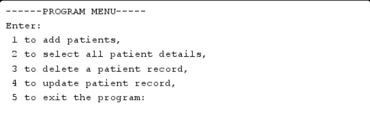
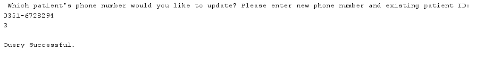
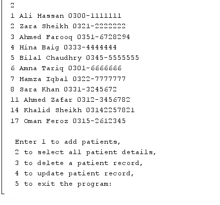

# Patient Record Management System (PRMS)

A Java and MySQL console application for managing patient records in a hospital database (`hms`). It runs from a simple text menu.

## Features
- Add a patient
- View all patients
- Update a patient's phone number
- Delete a patient

## Requirements
- JDK 25 (or lower `maven.compiler.release` in `pom.xml` to an older version you have installed)
- MySQL Server
- Maven (the MySQL driver downloads automatically through `pom.xml`)

## Setup
1. Install Java and MySQL.
2. Import `hms.sql` into MySQL. This creates the `hms` database.
3. Open `HMS.java` (`src/main/java/com/mycompany/hms/`) and replace `yourpassword` in the connection line with your own MySQL password. Change the username too if it isn't `root`.
4. Run `HMS.java`.

## Screenshots

**Menu**

**Updating a patient's phone number**

**Viewing all patients**

All patient names and phone numbers shown are made-up sample data.

## Future Work
Support for physicians, treatments, prescriptions, and the medicines prescribed to patients by physicians. The database (`hms.sql`) already contains these tables.

## Status
This project is a work in progress.
